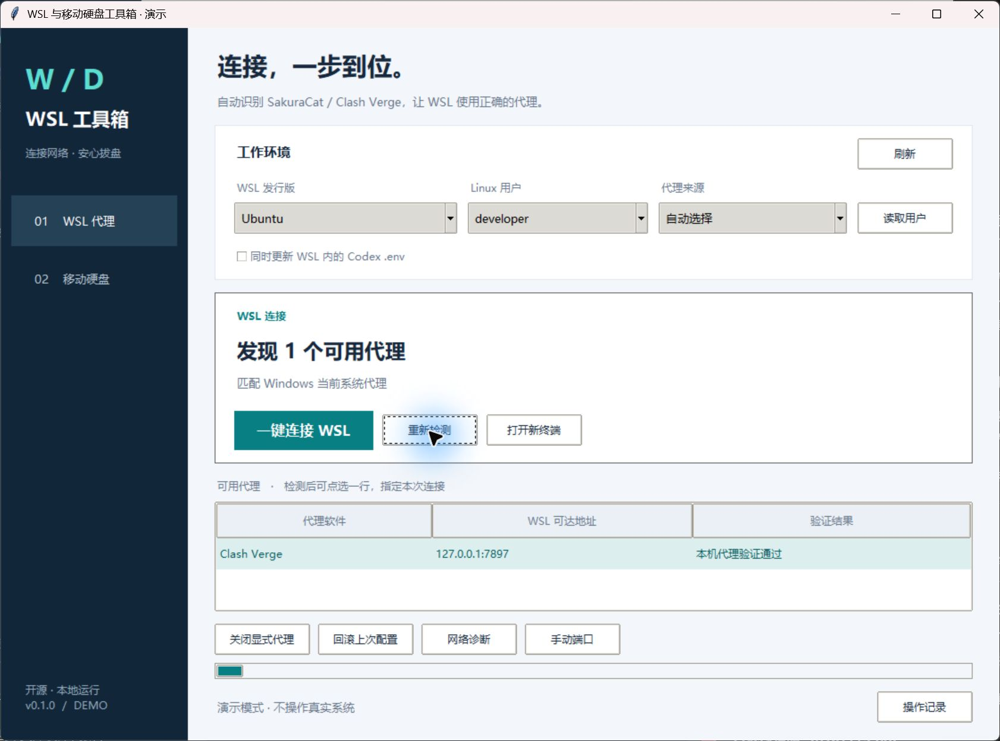
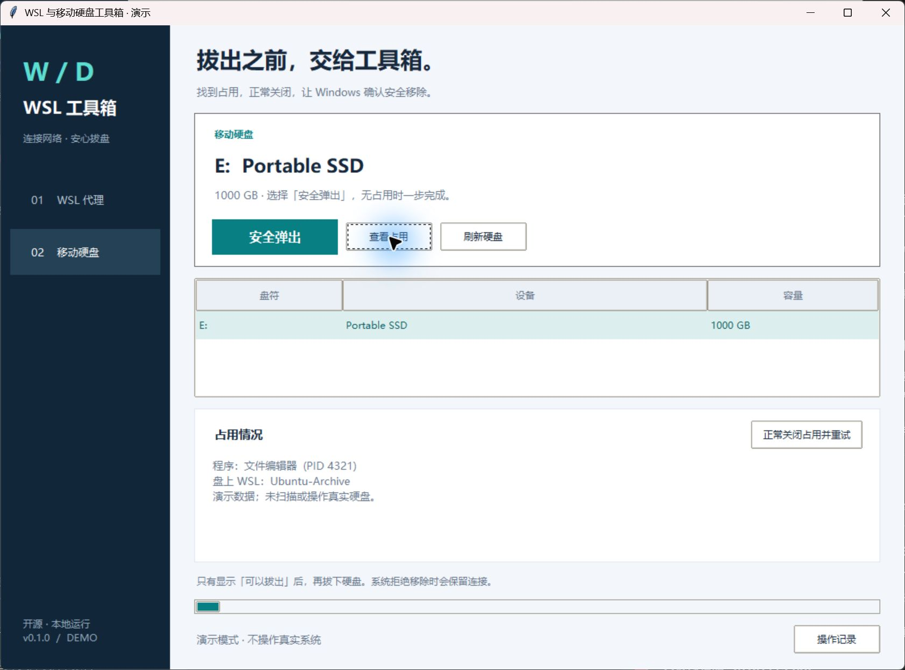

# WSL 与移动硬盘工具

一个中文 Windows 桌面小工具：检测正在运行的代理并配置 WSL，查看外接磁盘占用并请求 Windows 安全弹出。

A small Windows desktop utility for WSL proxy setup and external-drive diagnostics and safe ejection. Source execution uses Python's standard library only.



截图使用演示数据。项目采用 MIT 许可证。

## 开始使用

便携版可在 [GitHub Releases](https://github.com/yellkiin/wsl-drive-toolbox/releases) 下载。解压整个 ZIP 到内置磁盘，双击 `WSL-Drive-Toolbox.exe`，无需另外安装 Windows Python；目标 WSL 仍需 Python 3.8+。

需要 Windows 10/11、已安装的 WSL，以及 Windows Python 3.10 或更新版本（安装时保留 Tcl/Tk）。要配置代理，目标 WSL 内需要 Python 3.8 或更新版本（`python3`）。代理软件需由你自行安装并启动。

1. 下载源码并解压到内置磁盘。
2. 双击 `WSL与移动硬盘工具.cmd`，或在项目目录运行 `python start.py`。
3. 在代理页选择发行版和自己的 Linux 用户，再点“一键连接 WSL”。首次使用请明确选择日常使用的用户，不要随手选择 `root`。
4. 成功后打开一个新终端使用代理；已有终端和任务不会自动更新环境变量。

支持检测 SakuraCat、Clash Verge 的 HTTP 代理候选。多个候选无法明确区分时，需要选择后再连接。程序根据真实监听端点和 WSL 可达性验证，不要求固定端口。Codex 配置同步为可选项，使用前请保存相关工作；写入配置不保证已有 Codex 进程自动刷新。

“关闭显式代理”关闭本工具管理的代理设置；“回滚上次配置”尝试恢复最近一次配置变更。遇到外部改动冲突会保留现有内容并提示，请先检查相关文件。

## 安全弹出移动硬盘



先保存工作，再到移动硬盘页选择目标磁盘，查看型号、容量和同盘的全部盘符，然后点击“安全弹出”。只有界面明确显示 Windows 已允许安全移除时再拔出。

若系统拒绝移除，先查看占用和拒绝原因。选择“正常关闭占用并重试”前，核对界面列出的程序及 WSL 发行版。应用通过正常窗口关闭请求处理保存对话框，你仍需要完成保存或取消操作。无窗口程序、后台服务或无法确认的占用，可能需要自行退出。

WSL 的 `sync` 仅同步已经写出的文件，不会替应用保存未保存的内容。停止所选发行版会结束其中的任务，请先在对应 WSL 中保存并退出工作。工具不会强制结束程序、强制卸载卷或绕过 Windows 的移除拒绝。

占用诊断只能尽力识别，不能列出全部文件句柄或保证数据绝对安全。系统盘、分页文件所在盘、工具自身所在盘，以及无法确认身份或保护状态的磁盘会被拒绝。请把工具解压到不准备弹出的内置盘上。

## 常见问题

| 现象 | 处理方式 |
| --- | --- |
| 双击没有启动 | 在项目目录运行 `python start.py` 查看错误。运行 `python -m tkinter` 可确认 Windows Python 是否包含 Tk。 |
| 找不到发行版或 Linux 用户 | 先运行 `wsl --list --verbose` 检查 WSL 安装，并确认目标发行版和日常用户可正常登录。 |
| 提示缺少 `python3` | 在目标 WSL 中用该发行版的包管理器安装 Python 3，再重新连接。 |
| Windows 代理能用，WSL 连不上 | 在 NAT 网络下，仅监听 Windows 回环地址的代理可能无法从 WSL 访问。先查看网络诊断，再按你的代理软件和 WSL 配置处理。工具不会自动改防火墙、开放局域网监听或切换网络模式。 |
| 关闭代理后网络仍走代理 | WSL autoProxy、TUN、系统路由或其他程序的配置仍可能有效；本工具只管理自己的显式代理配置。 |
| 新终端生效，旧终端没有变化 | 关闭旧终端后重新打开，或在自己的 shell 中重新加载对应配置；已运行的进程保留启动时的环境。 |
| 磁盘没有列出或无法弹出 | 先确认是可验证的 USB 外接磁盘，再查看诊断信息。复杂卷映射、保护信息不足或 Windows veto 都会阻止自动弹出；请先处理原因。 |

支持 Bash、Zsh 的用户配置。APT、systemd 服务、Docker 容器及所有已运行进程的代理不在自动配置范围内。

## 命令行与演示

源码版支持以下入口；发行版名称和用户名请替换为自己的值：

```powershell
python -m toolbox
python start.py --demo
python -m toolbox --cli status --distro "YourDistro" --user "youruser"
python -m toolbox --cli scan --distro "YourDistro" --user "youruser"
python -m toolbox --cli connect --distro "YourDistro" --user "youruser"
python -m toolbox --cli off --distro "YourDistro" --user "youruser"
python -m toolbox --cli rollback --distro "YourDistro" --user "youruser"
python -m toolbox --cli diagnose --distro "YourDistro" --user "youruser"
python -m toolbox --help
```

`--demo` 展示模拟数据，不修改系统。实际可用参数以 `--help` 为准。命令行配置代理同样会修改所选 Linux 用户的配置。

## 开发与打包

源码运行无需安装第三方 Python 包。偏好保存在当前用户本地应用数据目录；不要把真实诊断输出、备份、`.env`、个人路径或设备标识提交到仓库。

```powershell
python -m unittest discover -s tests -v
python -m compileall -q toolbox tests start.py
```

测试使用临时文件及模拟 Windows 适配器。Windows 和 Ubuntu CI 执行单元测试及语法检查；通过这些检查不代表已完成真实硬盘弹出、两个代理同时运行或所有 Windows/WSL 配置的实机测试。

本次版本的验证范围见 [验证记录](docs/validation.md)。

在 Windows 安装可选打包依赖后执行：

```powershell
python -m pip install ".[build]"
powershell -ExecutionPolicy Bypass -File scripts/build.ps1
```

输出为 `dist/WSL-Drive-Toolbox/`，启动其中的 `WSL-Drive-Toolbox.exe`。请分发整个文件夹，不能只复制 EXE。打包包含 Windows Python 运行环境；目标 WSL 仍需 `python3`。EXE 为无控制台 GUI 程序，命令行输出请使用源码入口。

GitHub Actions 的手动运行和 `v*` 标签可生成 Windows ZIP 构建产物，需在实际 Windows 机器上启动检查后再分发。该流程不会自动创建 GitHub Release。

欢迎附上复现步骤提交问题；分享日志和截图前请遮去用户名、路径、代理凭据和磁盘标识。
