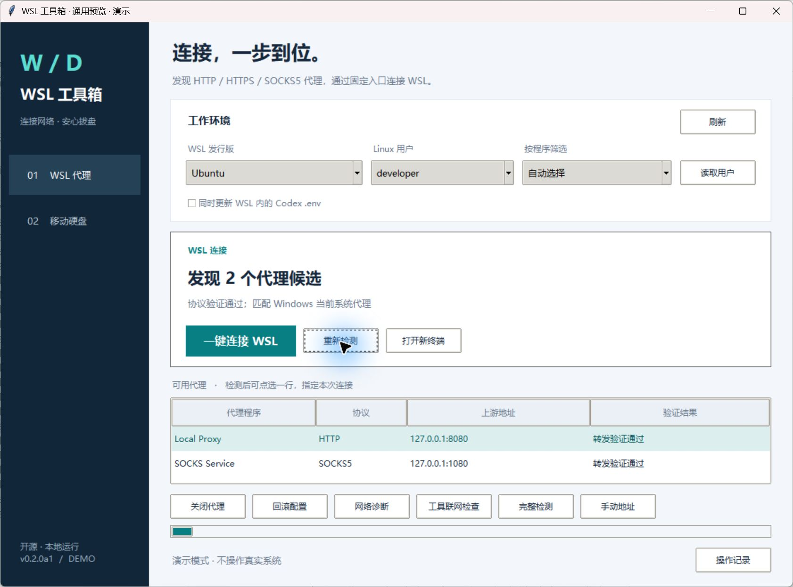
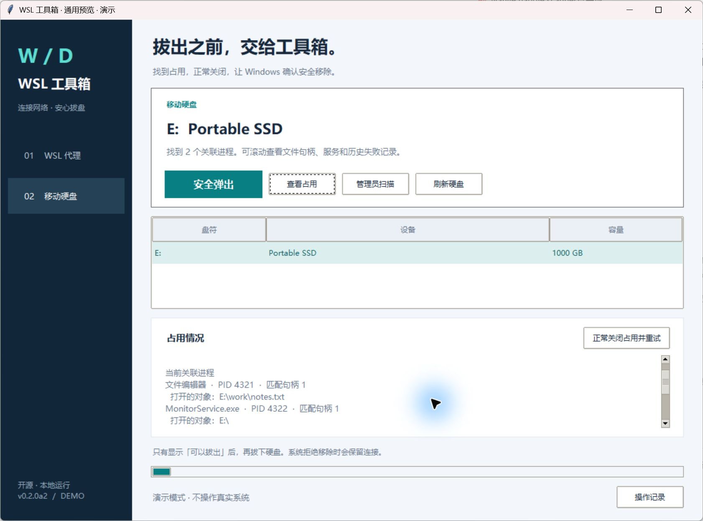

# WSL 与移动硬盘工具 · 通用代理预览版

当前 `feature/universal-proxy` 分支提供独立的 **0.2.0a2 预览版**：发现本机代理，通过固定 WSL HTTP 入口供命令行工具使用，并增加真实文件句柄占用扫描、关联服务诊断和按选择正常释放。

A Windows desktop utility for generic proxy discovery, a stable WSL HTTP gateway, application diagnostics, and external-drive safe ejection. This is an independent preview; source execution uses Python's standard library only.

继续使用原版可下载 [v0.1.0 稳定版](https://github.com/yellkiin/wsl-drive-toolbox/releases/tag/v0.1.0)。本次预览发布目标为 [v0.2.0-preview.2](https://github.com/yellkiin/wsl-drive-toolbox/releases/tag/v0.2.0-preview.2)；发布前请使用源码或 Actions 构建产物。新包名和输出目录与原版分开，便于分别试用。



截图使用演示数据。项目采用 MIT 许可证。

## 开始使用

预览便携包名称为 `WSL-Drive-Toolbox-Universal-windows.zip`。解压整个 ZIP 到内置磁盘，双击 `WSL-Drive-Toolbox-Universal.exe`，无需另外安装 Windows Python；目标 WSL 仍需 Python 3.8+。

需要 Windows 10/11、已安装的 WSL，以及 Windows Python 3.10 或更新版本（安装时保留 Tcl/Tk）。要配置代理，目标 WSL 内需要 Python 3.8 或更新版本（`python3`）。代理软件需由你自行安装并启动。

1. 下载源码并解压到内置磁盘。
2. 双击 `WSL与移动硬盘工具.cmd`，或在项目目录运行 `python start.py`。
3. 在代理页选择发行版和自己的 Linux 用户，再点“一键连接 WSL”。首次使用请明确选择日常使用的用户，不要随手选择 `root`。
4. 连接结果会分别显示验证过的上游和 WSL 本地入口。首次使用后重新打开终端或应用；已有进程的环境变量不会自动更新。

不再要求代理软件属于指定品牌：优先检测系统代理和已知监听，没有可用结果时扩展到本机实际监听端点，也可主动完整检测或手动填写地址。多个候选无法明确区分时，需要选择后再连接；协议和可达性验证通过才会应用。

| 预览范围 | 行为 |
| --- | --- |
| HTTP、HTTPS 代理、SOCKS5 | 支持无认证端点；HTTPS 代理指到代理服务器本身使用 TLS。 |
| WSL 命令行 | Bash/Zsh 加载统一代理变量，应用使用同一 localhost HTTP 入口。 |
| Node | 网关模式自动设置 `NODE_USE_ENV_PROXY=1`；支持的 Node 版本可采用环境代理，诊断会提示版本和适用范围。 |
| Codex | 可选同步 WSL CLI 的 `.env` 代理项；诊断版本和代理覆盖一致性。 |
| 应用诊断 | 检查 curl、Git、pip、npm、Node 的实际网络路径及独立代理覆盖。 |
| 认证、PAC、TUN-only | 不收集密码、不执行 PAC、不接管系统流量；给出限制提示。 |

WSL 入口 URL 在上游切换时保持不变，后续新连接读取新上游，已建立连接不会被主动切断。本地转发服务仅绑定 WSL `127.0.0.1`；关闭窗口后仍可运行。详细生命周期、关闭和回滚行为见 [预览版说明](docs/universal-preview.md)。

应用可以覆盖环境变量。请点击“工具联网检查”查看覆盖来源和实际路径；单独某个网络测试通过不代表所有工具都已走代理。Codex 同步不覆盖 Windows 桌面应用，也不验证付费模型 API、登录或账户权限。

“关闭显式代理”关闭本工具管理的代理设置；“回滚上次配置”尝试恢复最近一次配置变更。遇到外部改动冲突会保留现有内容并提示，请先检查相关文件。

## 安全弹出移动硬盘



1. **扫描**：先保存工作，在移动硬盘页核对目标型号、容量和全部盘符，点击“查看占用”。若有无权读取或扫描不完整的提示，可点击“管理员扫描”并处理 Windows UAC 授权；该扫描只读，不关闭程序或停止服务。
2. **选择**：查看当前进程、打开对象和关联服务，区分单独列出的历史弹出失败记录。点击“正常关闭占用并重试”，核对将处理的程序和 WSL；服务默认不停止，只勾选你明确需要停止且界面允许的服务。
3. **正常重试**：完成应用自己的保存提示。工具会记录每项处理结果，继续处理其余独立的已确认对象，并刷新剩余占用。只有 Windows 明确允许安全移除后再拔盘；无占用时也可直接点击“安全弹出”。

扫描会检查目标盘文件、目录、卷及原始磁盘的当前 File 类句柄，能识别程序装在内置盘、却打开外接盘对象的情况。关联服务按进程宿主展示，共享宿主不能证明其中每个服务都在访问目标盘。服务仅通过 Windows 服务管理器请求正常停止，不强杀宿主、禁用服务或递归停止依赖服务。

资源管理器只请求关闭指向目标盘的文件夹窗口，不结束整个 Explorer；同一窗口里的其他标签页也可能随窗口关闭。受保护进程、内核及映射文件占用仍可能无法完整归属，扫描没有发现对象也不代表可以拔盘。覆盖范围、管理员权限和历史记录的含义见 [硬盘占用说明](docs/disk-occupancy.md)。

WSL 的 `sync` 仅同步已经写出的文件，不会替应用保存未保存的内容。停止所选发行版会结束其中的任务，请先在对应 WSL 中保存并退出工作。工具不会强制结束程序、强制卸载卷或绕过 Windows 的移除拒绝。

占用诊断只能尽力识别，不能列出全部文件句柄或保证数据绝对安全。系统盘、分页文件所在盘、工具自身所在盘，以及无法确认身份或保护状态的磁盘会被拒绝。请把工具解压到不准备弹出的内置盘上。

## 常见问题

| 现象 | 处理方式 |
| --- | --- |
| 双击没有启动 | 在项目目录运行 `python start.py` 查看错误。运行 `python -m tkinter` 可确认 Windows Python 是否包含 Tk。 |
| 找不到发行版或 Linux 用户 | 先运行 `wsl --list --verbose` 检查 WSL 安装，并确认目标发行版和日常用户可正常登录。 |
| 提示缺少 `python3` | 在目标 WSL 中用该发行版的包管理器安装 Python 3，再重新连接。 |
| Windows 代理能用，WSL 连不上 | 在 NAT 网络下，仅监听 Windows 回环地址的代理可能无法从 WSL 访问。先查看网络诊断，再按你的代理软件和 WSL 配置处理。工具不会自动改防火墙、开放局域网监听或切换网络模式。 |
| 关闭代理后网络仍走代理 | WSL autoProxy、TUN、系统路由或其他程序的配置仍可能有效；本工具只管理自己的显式代理配置。 |
| 新终端生效，旧终端没有变化 | 首次配置或采用新入口后需重开终端/应用；已使用固定入口的进程可在后续新连接中跟随上游切换。 |
| 入口可用，但某个工具没走代理 | 运行“应用诊断”，检查 `no_proxy`、Git、pip、npm 等独立配置。诊断保留这些设置，不批量删除。 |
| 安装在内置盘的程序占用外接盘 | “查看占用”会按打开对象查找，不只检查程序安装目录；有无权读取时可使用只读“管理员扫描”。 |
| 磁盘没有列出或无法弹出 | 查看当前占用、扫描覆盖和系统拒绝原因。历史 Kernel-PnP 225 记录不等于当前占用；复杂卷映射、保护信息不足或 Windows veto 都会阻止自动弹出。 |

支持 Bash、Zsh 的用户配置。APT、systemd 服务、Docker 容器及所有已运行进程的代理不在自动配置范围内。

## 命令行与演示

源码版支持以下入口；发行版名称和用户名请替换为自己的值：

```powershell
python -m toolbox
python start.py --demo
python -m toolbox --cli status
python -m toolbox --cli scan --distro "YourDistro" --user "youruser"
python -m toolbox --cli connect --distro "YourDistro" --user "youruser"
python -m toolbox --cli off --distro "YourDistro" --user "youruser"
python -m toolbox --cli rollback --distro "YourDistro" --user "youruser"
python -m toolbox --cli diagnose --distro "YourDistro" --user "youruser"
python -m toolbox --help
```

`--demo` 展示模拟数据，不修改系统。实际可用参数以 `--help` 为准。命令行配置代理同样会修改所选 Linux 用户的配置。

## 开发与打包

源码运行无需安装第三方 Python 包。偏好保存在当前用户本地应用数据目录；不要把真实诊断输出、备份、`.env`、个人路径或设备标识提交到仓库。

```powershell
python -m unittest discover -s tests -v
python -m compileall -q toolbox tests start.py
```

测试使用临时文件及模拟 Windows 适配器。Windows 和 Ubuntu CI 执行单元测试及语法检查；通过这些检查不代表已完成真实硬盘弹出、两个代理同时运行或所有 Windows/WSL 配置的实机测试。

本次预览版的实际测试见 [通用版验证记录](docs/universal-validation.md)，使用方式见 [预览版说明](docs/universal-preview.md)。[v0.1.0 验证记录](docs/validation.md) 也继续保留。

在 Windows 安装可选打包依赖后执行：

```powershell
python -m pip install ".[build]"
powershell -ExecutionPolicy Bypass -File scripts/build-universal.ps1
```

预览输出为 `dist-universal/WSL-Drive-Toolbox-Universal/`，启动其中的 `WSL-Drive-Toolbox-Universal.exe`，不会改写原有 `dist/`。请分发整个文件夹，不能只复制 EXE。打包包含 Windows Python 运行环境、原生句柄扫描与管理员助手，以及三个 WSL helper 源文件；目标 WSL 仍需 `python3`。占用扫描无需安装第三方工具或驱动。EXE 为无控制台 GUI 程序，命令行输出请使用源码入口。

通用 `scripts/build.ps1` 仍默认输出 `dist/WSL-Drive-Toolbox/`，也接受 `-Name` 和 `-DistPath`。在当前分支运行它会打包当前预览源码；如需原版，请使用 v0.1.0 发布资产或相应源码。

GitHub Actions 在预览分支推送、手动运行和 `v0.2.0-preview.*` 标签时，测试通过后生成单独的 Windows 预览 ZIP 构建产物，需在实际 Windows 机器上启动检查后再分发。该流程不会自动创建 GitHub Release。

欢迎附上复现步骤提交问题；分享日志和截图前请遮去用户名、路径、代理凭据和磁盘标识。
