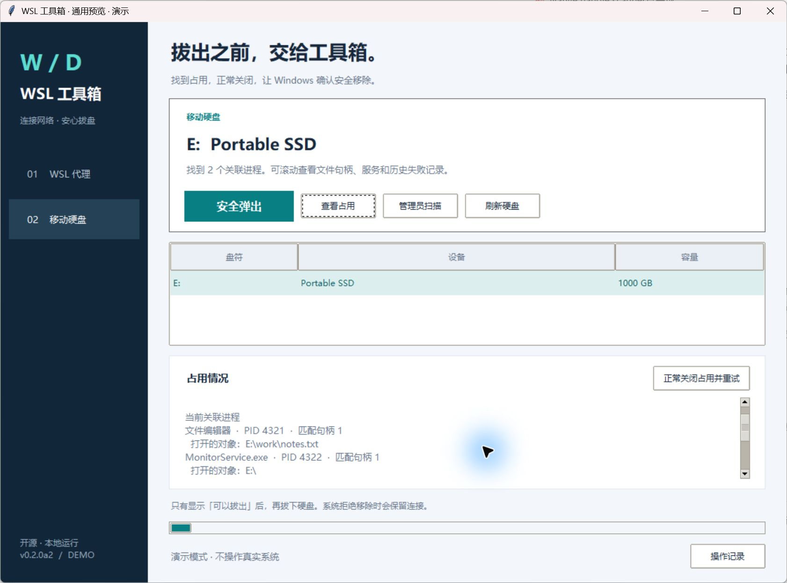

# 硬盘占用扫描与正常释放

本说明对应 0.2.0a2 / `v0.2.0-preview.2` 的硬盘占用改进。工具通过 Windows 原生接口扫描打开对象，不下载或捆绑 Sysinternals，也不安装驱动。

## 三步使用

1. 选择目标硬盘，核对型号、容量和同盘全部盘符，点击“查看占用”。若提示权限不足，可点击“管理员扫描”并接受 Windows UAC。管理员扫描只读取当前证据，不进行清理。
2. 保存相关工作，再点击“正常关闭占用并重试”。核对已列出的程序和 WSL；服务默认不停止，仅勾选本次明确需要正常停止的可选服务。不可选项目会显示原因。
3. 完成应用的保存对话框，查看各项处理结果和刷新的剩余占用。仍未释放时先处理原因再重试；只有 Windows 允许安全移除后再拔盘。

## 当前证据与扫描覆盖

扫描检查系统 File 类句柄，按目标物理盘的卷与设备别名匹配文件、目录、卷及原始磁盘对象。因此，程序即使安装在内置盘，打开外接盘对象时仍可能被识别。它不扫描文件正文，也不只靠程序安装位置猜测占用。

结果会分别展示打开对象、程序运行位置及系统资源关联等证据。关联到进程的服务按宿主进程列出；若多个服务共享宿主，这只能证明宿主相关，不能证明每个服务各自访问了目标盘。

覆盖信息包括已检查/总文件类句柄数、无权读取的进程数、无法解析的名称，以及是否达到时间上限。超时会保留已经找到的结果，不能将未检查部分视为没有占用。未找到对象只表示本次扫描范围内未找到证据。

“管理员扫描”通过 UAC 启动本工具的单次助手，使用本地请求/结果文件返回信息，不把整个 GUI 长期提升为管理员。只读实机验证已确认管理员权限可扩大实际可读取的句柄范围，但仍不能保证读取受保护进程、完整归属内核对象或识别所有映射文件占用。

## 历史拒绝记录

目标匹配的 Windows Kernel-PnP 事件 225 单独列为历史弹出失败记录，供排查当时的阻止者。历史进程可能已经退出、释放文件或被其他进程复用了编号；这些记录不会单独作为当前关闭对象或服务停止依据。当前证据与 Windows 本次移除结果才决定下一步。

## 正常关闭如何处理

普通应用收到正常窗口关闭请求，由应用决定保存、取消或拒绝。资源管理器只处理指向目标盘的文件夹窗口，不结束整个 Explorer 桌面进程；若同一窗口包含其他标签页，这些标签页也可能随窗口一起关闭。无法确认目标窗口时不会扩大为关闭整个 Explorer。

仅对用户明确勾选且仍符合条件的服务，通过 Windows 服务管理器发送正常停止请求。执行前复查服务状态、进程身份和保护属性；核心系统、安全、驱动、共享宿主或不能验证条件的服务不提供自动停止。不强杀服务宿主、不禁用服务、不连带停止依赖服务。

某个应用拒绝关闭或某项正常释放失败时，其余独立且已确认的清理仍会继续，结果按项汇总并重新扫描剩余占用。有未完成项时不会把它显示为整体成功，也不会绕过保存提示继续弹出。新出现的占用或身份变化需要重新检查和确认。

WSL 的 `sync` 只同步已经写出的数据，不能保存应用内存中的工作。停止选定发行版会结束其中任务，必须先保存。忙挂载不强制卸载，文件句柄不强制关闭。

最终安全移除仍由 Windows PnP 决定；拒绝、超时或设备丢失都不能当作允许拔盘。管理员权限能扩大诊断范围，也不能绕过这个结果。

## 开发与验证边界

句柄扫描、服务停止和清理编排使用标准库实现，源码及便携包均不需要额外扫描依赖。原生句柄查询放在有时间边界的同程序助手中；管理员操作使用单独的本地文件通信入口。

2026-11-17 本地 Windows 完整套件运行 144 项，无失败，5 项平台/可选依赖测试跳过。隔离占用者的真实文件和目录句柄，以及只读卷/原始磁盘句柄已验证；源程序的普通/管理员扫描及结果回传已经实测，打包后 EXE 的无控制台助手也完成了真实只读扫描。

服务停止、资源管理器定向关闭及取消保存等路径使用模拟测试，不等于已验证在每台电脑上的真实停止/弹出效果。开发过程中没有关闭用户应用、停止实际服务、卸载用户挂载或弹出真实硬盘。公开截图均为虚构的演示数据。
